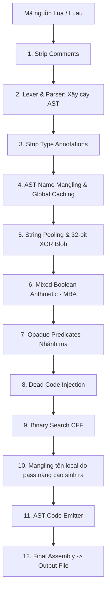

# Luau Obfuscator

> **Bộ công cụ bảo mật và làm rối mã nguồn Lua / Luau (Roblox & Lune CLI) viết bằng Python.**  
> Thiết kế để script game chạy mượt **60 FPS**, **bảo toàn 100% ngữ nghĩa logic**, chống dịch ngược bởi con người và AI decompiler.

---

## 📑 Mục lục

1. [Tính năng nổi bật](#1-tính-năng-nổi-bật)
2. [Cấu trúc dự án](#2-cấu-trúc-dự-án)
3. [Kiến trúc Pipeline](#3-kiến-trúc-pipeline)
4. [Cài đặt & Môi trường](#4-cài-đặt--môi-trường)
5. [Hướng dẫn sử dụng](#5-hướng-dẫn-sử-dụng)
   - [Sử dụng dòng lệnh (CLI)](#sử-dụng-dòng-lệnh-cli)
   - [Các Preset có sẵn](#các-preset-có-sẵn)
   - [Xử lý thư mục hàng loạt (Batch Mode)](#xử-lý-thư-mục-hàng-loạt-batch-mode)
   - [Sử dụng qua Python API](#sử-dụng-qua-python-api)
6. [Chi tiết các tầng bảo vệ](#6-chi-tiết-các-tầng-bảo-vệ)
7. [Kiểm thử (Test Suite)](#7-kiểm-thử-test-suite)
8. [Đóng gói phát hành (.exe)](#8-đóng-gói-phát-hành-exe)
9. [Lộ trình phát triển (Roadmap)](#9-lộ-trình-phát-triển-roadmap)

---

## 1. Tính năng nổi bật

- 🛡️ **Bảo mật đa tầng**: Kết hợp các bước làm rối từ AST đến chuỗi byte và cấu trúc điều khiển.
- ⚡ **Zero-Dependency**: 100% Python Standard Library, không cần cài đặt thêm thư viện pip bên ngoài.
- 🎯 **Ngữ pháp Luau hiện đại**: Hỗ trợ đầy đủ cú pháp đặc thù của Luau:
  - Kiểu dữ liệu và ép kiểu (`: type`, `:: any`, `--!strict`, `type Alias = ...`).
  - Phép gán kết hợp: `+=`, `-=`, `*=`, `/=`, `%=`, `^=`, `..=`.
  - Lệnh điều khiển nâng cao: `continue`, `repeat...until`, method calling `:`, numeric & generic for.
  - Chuỗi nhiều dòng: Long String (`[[ ... ]]`).
- 🔄 **CFF cây nhị phân (Binary Search Dispatcher)**: Làm phẳng luồng điều khiển với độ phức tạp $O(\log_2 N)$ dùng toán tử `<`, relay an toàn `break` và `continue` qua mọi tầng lồng nhau.
- 🚀 **Runtime Runner tích hợp**: Tự động phát hiện và chạy kiểm thử ngay lập tức file sau obfuscate bằng `bin/lune.exe` hoặc `luau.exe`.

---

## 2. Cấu trúc dự án

```text
LuauObfuscator/
├── bin/
│   └── lune.exe              # Runtime Lune CLI (tương thích Luau + thư viện mở rộng)
├── build/                    # Script build một lần
├── dist/                     # File sau khi Obfuscate
├── src/
│   ├── parser/               # Bộ phân tích cú pháp AST
│   │   ├── lexer.py          # Tokenizer
│   │   ├── parser.py         # Trình dựng cây AST
│   │   ├── nodes.py          # Khai báo các Node AST
│   │   └── traversal.py      # Tiện ích duyệt và biến đổi cây AST
│   ├── basic/                # Tầng 1: Dữ liệu cơ bản
│   │   ├── annotations.py    # Loại bỏ type annotations Luau
│   │   ├── comment.py        # Minify và xóa chú thích
│   │   ├── naming.py         # AST Variable Mangling & Global Caching
│   │   └── strings.py        # Monolithic String Pooling & XOR 32-bit
│   ├── advanced/             # Tầng 2: Luồng nâng cao & Phòng vệ
│   │   ├── cff.py            # Control Flow Flattening (B-Search CFF)
│   │   ├── mba.py            # Mixed Boolean Arithmetic
│   │   ├── opaque_predicates.py # Điều kiện mờ & nhánh ma thích ứng clock
│   │   ├── dead_code.py      # Bơm rác logic đè bẹp AI context
│   │   ├── anti_tamper.py    # Active Defense (table.freeze, metatable lock)
│   │   └── emitter.py        # In cây AST thành mã nguồn Lua tối ưu
│   ├── utils/                # Tiện ích chung
│   │   └── crypto.py         # Sinh khóa ngẫu nhiên CSPRNG & mã hóa XOR
│   ├── vm/                   # Tầng 3: Máy ảo tùy biến (Đang phát triển)
│   │   ├── opcode.py         # Khai báo 32 Opcode lai RISC/CISC
│   │   ├── compiler.py       # Dịch AST sang bytecode bit-packed 32-bit
│   │   ├── environment.py    # Quản lý Constant Pool và thanh ghi
│   │   └── runtime_template.py # Khung Lua dispatcher Zero-GC
│   └── main.py               # Pipeline điều phối & CLI Runner
├── tests/                    # Bộ kiểm thử đơn vị & tích hợp (90 tests)
├── run_tests.py              # Trình chạy toàn bộ test suite tập trung
├── TEST_REPORT.md            # Báo cáo kết quả kiểm thử & chi tiết các lỗi đã sửa
└── README.md                 # Tài liệu hướng dẫn sử dụng này
```

---

## 3. Kiến trúc Pipeline

Mã nguồn được xử lý tuần tự qua **12 bước**:



---

## 4. Cài đặt & Môi trường

### Yêu cầu
- **Python**: Phiên bản `3.10` trở lên (Khuyến nghị dùng `3.11+` hoặc `PyPy3`).
- **Không cần cài thêm thư viện phụ thuộc (`pip install`)**.
- Bộ thực thi runtime kiểm thử (`bin/lune.exe`) đã được đính kèm sẵn.

---

## 5. Hướng dẫn sử dụng

### Sử dụng dòng lệnh (CLI)

Chạy trực tiếp qua Python:

```bash
# Obfuscate cơ bản (đầu ra mặc định: dist/<tên_file>_obf.luau)
python src/main.py script.luau

# Chỉ định file đầu ra
python src/main.py script.luau -o dist/protected.luau

# Obfuscate và tự động chạy thử ngay bằng Lune CLI
python src/main.py script.luau --run

# Dùng VM backend cho phần cú pháp Lua/Luau mà compiler hiện hỗ trợ
python src/main.py script.luau --enable-vm
```

`--enable-vm` chọn VM backend thay cho các pass obfuscation AST thông thường.
Sau khi sinh VM runtime, pipeline vẫn áp dụng name mangling và string pooling
theo cấu hình; các pass global caching, MBA, opaque predicates, dead code và CFF
được bỏ qua. Xem [VM_README.md](VM_README.md) để biết các giới hạn cú pháp.

Có thể chạy nhanh trên Windows bằng `build\build.cmd`. Lệnh này mặc định dùng
VM backend; truyền file nguồn và có thể truyền thêm đường dẫn output:

```bat
build\build.cmd vm_compatible_script.luau
build\build.cmd vm_compatible_script.luau dist\protected.luau
```

VM hiện chỉ hỗ trợ một tập con Lua/Luau; cú pháp chưa hỗ trợ và giới hạn
bytecode sẽ báo lỗi thay vì sinh output không phải VM. Để dùng pipeline AST
obfuscation cũ qua CMD, thêm `--standard` ở đối số thứ ba:
`build\build.cmd complex_test.luau dist\complex_test_obf.luau --standard`.

### Các Preset có sẵn

Công cụ cung cấp 3 cấu hình nhanh qua cờ `--preset`:

| Preset | Đặc điểm | Trường hợp sử dụng |
|---|---|---|
| `min` | Chỉ xóa comment, lột type, mangle biến, minify. Không CFF, không chuỗi mã hóa. Kích thước giảm 30-50%. | Script cần dung lượng cực nhẹ, chạy tối đa tốc độ. |
| `balanced` *(mặc định)* | Áp dụng CFF, pool tất cả string literal, MBA vừa phải, Opaque Predicates và Dead Code. | Cân bằng giữa mức độ làm rối và hiệu năng. |
| `max` | Tối đa hóa xác suất MBA, CFF sâu mọi block con và mật độ Dead Code. | Bảo vệ các thuật toán nhạy cảm, chống decompiler cấp cao. |

**Ví dụ:**
```bash
# Dùng chế độ nhẹ nhất
python src/main.py script.luau --preset min

# Dùng chế độ bảo vệ tối đa và chạy thử
python src/main.py script.luau --preset max --run
```

### Xử lý thư mục hàng loạt (Batch Mode)

Nếu đường dẫn đầu vào là một thư mục, công cụ sẽ tự động quét đệ quy toàn bộ file `.luau` và `.lua` rồi xuất vào thư mục đích:

```bash
python src/main.py my_project/ -o dist/obfuscated_project/
```

### Đọc/Ghi qua luồng chuẩn (`stdin` / `stdout`)

Hỗ trợ nối ống lệnh (pipe) bằng ký tự `-`:

```bash
cat input.luau | python src/main.py - -o - > output.luau
```

### Bật / Tắt chi tiết từng Pass

Bạn có thể tùy biến sâu bằng các cờ:
```bash
python src/main.py input.luau \
  --no-cff               # Tắt Control Flow Flattening \
  --no-mba               # Tắt Mixed Boolean Arithmetic \
  --no-strings           # Không mã hóa chuỗi literal \
  --no-dead-code         # Không bơm code rác \
  --no-opaque            # Không chèn điều kiện mờ \
  --no-mangle            # Giữ nguyên tên biến local \
  --no-global-cache      # Không cache global vào local \
  --seed 12345           # Đặt seed ngẫu nhiên cố định để tái lập kết quả
```

---

### Sử dụng qua Python API

Tích hợp trực tiếp vào script build Python:

```python
from src.main import ObfuscationPipeline, PipelineConfig

# 1. Khởi tạo cấu hình từ preset hoặc tự chỉnh
cfg = PipelineConfig.from_preset("balanced", dialect="roblox")

# 2. Tạo pipeline
pipeline = ObfuscationPipeline(cfg)

# 3. Thực thi obfuscate
source_code = """
local function calculate(a: number, b: number): number
    return (a + b) * 2
end
print(calculate(10, 20))
"""

result = pipeline.process(source_code)

# 4. Nhận kết quả
print("Mã nguồn sau khi làm rối:\n", result.output_code)
print(f"Kích thước ban đầu: {result.original_size} bytes")
print(f"Kích thước sau obf: {result.obfuscated_size} bytes")
print(f"Thời gian xử lý:    {result.elapsed_seconds * 1000:.2f} ms")
```

---

## 6. Chi tiết các tầng bảo vệ

### 1. AST Name Mangling & Scope Shadowing (`naming.py`)
- Phân tích phạm vi từ vựng (Lexical Scopes) chuẩn xác trên cây AST.
- Đổi tên: biến `local`, hàm `local`, tham số hàm, biến vòng lặp, upvalues.
- Tên biến mặc định dài 8–10 ký tự (không tính tiền tố `_`), chọn ngẫu nhiên từ alphabet dễ nhầm `l`, `I`, `i`, `1`.
- Tái sử dụng tên tối đa (Scope Shadowing) để gây nhầm lẫn luồng dữ liệu cho decompiler.
- Bảo vệ an toàn: Globals môi trường (`print`, `game`, `workspace`, `math`), Engine Properties/Events, Metamethods (`__index`, `__newindex`), và tham số ẩn `self` trong method `:`.
- Field/key của table local chỉ được đổi khi chứng minh được nguồn khởi tạo nội bộ; alias và table lồng được theo dõi. Table đi qua lời gọi hàm/return, key động, có closure hoặc rebind làm nguồn field không còn chắc chắn sẽ giữ nguyên field names.
- Tự động hoisting và gom biến toàn cục dùng nhiều lần (`local _a = math.floor`).
- Sau các pass nâng cao, đưa decoder string vào AST rồi chạy lượt name mangling cuối để local do decoder, opaque predicates/CFF sinh ra cũng dùng alphabet `l`, `I`, `i`, `1`; lượt này không đổi lại field của table. Lớp giải mã ngoài của loader dùng chung allocator để theo quy tắc đó.

### 2. Monolithic String Pooling & 32-bit XOR Blob (`strings.py`)
- Gom toàn bộ chuỗi literal vào một mảng byte nhị phân tập trung duy nhất (Monolithic Blob).
- Mã hóa bằng khóa ngẫu nhiên 32-bit theo từng khối 4-byte.
- Thay thế mọi chuỗi literal, kể cả chuỗi ngắn và rỗng, bằng lời gọi hàm giải mã `_S(offset, length)` khi bật string pooling.
- Hàm giải mã được viết bằng thuật toán XOR thuần túy, không phụ thuộc thư viện `bit32`, chạy an toàn trên cả Luau và Lua 5.1.

### 3. Mixed Boolean Arithmetic - MBA (`mba.py`)
- Biến đổi các biểu thức số học quen thuộc thành dạng tương đương phức tạp dựa trên đại số Boolean:
  - $x + y \Longleftrightarrow (x \oplus y) + 2(x \land y)$
  - $x - y \Longleftrightarrow (x \oplus \neg y) + 1 - 2(\neg x \land \neg y)$
- Phân rã hằng số (Constant K-Split) thành các chuỗi phép tính đa tầng.
- Chỉ biến đổi biểu thức có toán hạng numeric đã xác định an toàn; giữ nguyên phép toán vector như `origin + direction * scale`.
- Tự động bảo vệ các hàm có hiệu ứng phụ (side-effects) để tránh gọi lặp hàm.

### 4. Opaque Predicates (`opaque_predicates.py`)
- Tạo các biểu thức điều kiện luôn đúng hoặc luôn sai lúc runtime nhưng decompiler không thể tối ưu hóa lúc phân tích tĩnh.
- Tự động thích ứng runtime: Dialect `roblox` tự động sử dụng `(tick or os.clock)()` đảm bảo hoạt động tương thích kép trên cả Roblox Studio lẫn Lune/Luau CLI.
- Nhận diện các câu lệnh phân kỳ (`return`, `break`, `continue`) để không chèn nhánh ma sai ngữ pháp.

### 5. Control Flow Flattening - CFF (`cff.py`)
- Băm nhỏ các khối lệnh tuần tự thành các Basic Block.
- Đặt mã trạng thái ngẫu nhiên không liên tục cho từng block.
- Gom toàn bộ vào vòng lặp điều phối dạng **cây tìm kiếm nhị phân $O(\log_2 N)$** sử dụng toán tử `<`.
- **Relay đa tầng**: Đảm bảo các lệnh `break` và `continue` bên trong các câu lệnh lồng nhau (`if`, `do`) được dẫn truyền chính xác ra vòng lặp ngoài cùng mà không bị nuốt bởi dispatcher nội bộ.

### 6. Anti-Tamper độc lập (`anti_tamper.py`, không thuộc pipeline)
- Module vẫn được giữ lại và có thể được gọi riêng qua API.
- Pipeline và các preset không tự chèn Anti-Tamper vào output.
- **`table.freeze`**: Đóng băng bộ nhớ của các bảng nhạy cảm (bảng key giải mã chuỗi, cache table) với fallback an toàn.
- **Metatable Locking**: Gán `__metatable = "Locked"`, kết hợp bẫy `__newindex` gây treo vòng lặp vô tận nếu có script lạ tìm cách hook hoặc monkey-patch.
- **Silent Corruption Guard**: Kiểm tra tính nguyên bản của các hàm cốt lõi (`type`, `pcall`, `setmetatable`). Nếu phát hiện bị can thiệp, công cụ **không báo lỗi** mà âm thầm gây sai lệch kết quả tính toán nhằm làm tê liệt bot/exploit decompiler.

---

## 7. Kiểm thử (Test Suite)

Dự án sở hữu bộ test toàn diện bao phủ toàn bộ các tầng chức năng:

```bash
# Chạy toàn bộ 90 test cases:
python run_tests.py
```

Chạy riêng theo từng phân vùng:
```bash
python run_tests.py --module parser       # 32 tests cú pháp AST
python run_tests.py --module utils        # 10 tests mã hóa & CSPRNG
python run_tests.py --module basic        # 18 tests gọt type, naming, strings
python run_tests.py --module advanced     # 17 tests CFF, MBA, Anti-Tamper, Emitter
python run_tests.py --module integration  # 9 tests Full Pipeline end-to-end
```

Chi tiết các báo cáo lỗi và lịch sử sửa lỗi được lưu trữ tại [TEST_REPORT.md](TEST_REPORT.md).

---

## 8. Đóng gói phát hành (.exe)

Để đóng gói thành file `.exe` độc lập cho người dùng cuối không cần cài đặt Python, sử dụng **Nuitka Free**:

```bash
# 1. Cài đặt Nuitka
pip install nuitka

# 2. Biên dịch Standalone Onefile với tối ưu hóa
python -m nuitka --standalone --onefile --lto=yes src/main.py -o Obfuscator_Turbo.exe
```

---

## 9. Lộ trình phát triển (Roadmap)

- [x] Tầng Parser & AST Node Representation (Luau Specification)
- [x] Tầng Basic (Comment, Annotations, AST Name Mangling, String Pooling)
- [x] Tầng Advanced (Binary-Search CFF, MBA, Opaque Predicates, Dead Code)
- [x] Module Anti-Tamper độc lập (không được gọi trong pipeline)
- [x] Pipeline Orchestrator & CLI Runner (`src/main.py`)
- [x] Bộ test toàn diện chạy trên Lune/Luau runtime (90/90 tests PASS)
- [x] **Tầng VM (Register-based Luau Virtual Machine, subset)**:
  - Compiler bytecode 32-bit và runtime dispatcher (`src/vm/`).
  - Tích hợp backend tùy chọn `--enable-vm` vào pipeline chính.
- [ ] Mở rộng VM để hỗ trợ đầy đủ Luau, đặc biệt `goto`/label và các
  opcode/toán tử còn thiếu.

---

**Tác giả:** Luau Obfuscator Team  
**Giấy phép:** MIT License - Miễn phí 100%, không giới hạn tính năng.
"# LuauObfuscator" 
